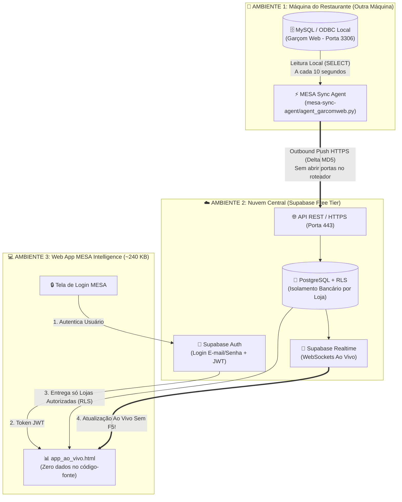

# 🍽️ MESA Intelligence · Conectividade Ao Vivo (Garçom Web Direct $\rightarrow$ Supabase $\rightarrow$ Web App Seguro)

[]()
[-10b981.svg?style=flat-square)]()
[]()
[]()

[-Supabase%20Realtime-10b981.svg?style=for-the-badge)](https://jonatasndossantos.github.io/mesa-intelligence-powerbi-gateway/app_ao_vivo.html)
[](https://jonatasndossantos.github.io/mesa-intelligence-powerbi-gateway/)

Plataforma de inteligência gerencial e consolidação financeira em **tempo real** para restaurantes da **Consultoria MESA**. Conecta diretamente ao banco de dados local dos clientes (**Garçom Web - MySQL/ODBC**) na máquina do restaurante através do **MESA Sync Agent** e transmite ao vivo para o **Supabase (PostgreSQL + Auth + Row Level Security + Realtime WebSockets)**.

---

## 🏗️ Arquitetura Fim-a-Fim (Cenário de Máquinas Separadas)

O banco de dados do **Garçom Web** roda fisicamente no computador local do restaurante (atrás de firewall/NAT/IP dinâmico), enquanto o site é acessado na nuvem por celulares e computadores de qualquer lugar:



---

## 🛡️ Diferenciais de Segurança e Engenharia

1. **Zero Dados no Código-Fonte (`app_ao_vivo.html`):**
   - O arquivo da aplicação caiu de **8,28 MB** para apenas **241 KB**.
   - Nenhum número de venda, produto ou DRE está presente no código HTML antes do login.
2. **Isolamento Multi-Tenant via PostgreSQL RLS (`Row Level Security`):**
   - A tabela `public.user_lojas` vincula cada e-mail de usuário às lojas permitidas (`10603`, `15173`, ou perfil `admin` da Consultoria MESA).
   - O próprio motor do banco de dados bloqueia qualquer tentativa de leitura de lojas não autorizadas.
3. **Atualização Ao Vivo (`Supabase Realtime`):**
   - Quando uma comanda é fechada ou um item é cancelado no Garçom Web, o `MESA Sync Agent` detecta a diferença via Hash MD5 e faz `UPSERT` no Supabase.
   - O navegador recebe o evento via WebSocket em milissegundos, reconstrói os índices em memória (`window.__refreshMesaRealtime()`) e atualiza os gráficos na hora, sem recarregar a página.
4. **Suporte Híbrido no Restaurante (MySQL Direto + ODBC Windows):**
   - O pacote portátil `mesa-sync-agent/` conecta tanto direto na porta `3306` do MySQL quanto via fonte de dados `ODBC` do Windows.

---

## 🚀 Guia de Implantação em 3 Passos

### Passo 1: Preparar o Banco no Supabase (2 minutos)
Siga o guia detalhado em **[`supabase/GUIA_PASSO_A_PASSO_SUPABASE.md`](supabase/GUIA_PASSO_A_PASSO_SUPABASE.md)**:
1. Crie um projeto gratuito em [supabase.com](https://supabase.com).
2. No **SQL Editor**, cole e execute o script **[`supabase/01_schema_and_rls.sql`](supabase/01_schema_and_rls.sql)**.
3. Crie seus usuários em **Authentication $\rightarrow$ Users** e vincule-os às lojas com:
   ```sql
   SELECT public.vincular_usuario_por_email('admin@mesa.com.br', NULL, 'admin');
   SELECT public.vincular_usuario_por_email('worldcafe@cliente.com', 10603, 'cliente');
   SELECT public.vincular_usuario_por_email('raimundao@cliente.com', 15173, 'cliente');
   ```

### Passo 2: Testar Hoje Mesmo Desta Máquina (Carga + Simulador Ao Vivo)
Mesmo com o Garçom Web estando em outra máquina, você pode popular o Supabase agora mesmo com os dados reais já extraídos do **World Café** e **Templo do Raimundão**:
1. Dê duplo clique em **`popular_supabase.bat`** (ele pedirá a `Project URL` e a `service_role key` do seu Supabase e subirá todas as lojas, vendas e módulos).
2. Abra o **`app_ao_vivo.html`**, faça login com seu e-mail e senha.
3. Dê duplo clique em **`simular_tempo_real.bat`** para simular novas comandas sendo fechadas a cada 5 segundos e veja os números mudando sozinhos na tela do navegador!

### Passo 3: Levar o Kit Coletor para a Outra Máquina (Onde está o Garçom Web)
Copie apenas a pasta **[`mesa-sync-agent/`](mesa-sync-agent/)** para o computador onde roda o Garçom Web:
1. Na outra máquina, rode `instalar_dependencias.bat`.
2. Edite o arquivo `config.env` com a senha do MySQL/ODBC local e a chave do Supabase.
3. Rode `testar_conexao.bat` para diagnosticar as tabelas locais.
4. Rode `iniciar_agente.bat` para iniciar a transmissão ao vivo!

---

## 📂 Estrutura Completa do Projeto

```text
mesa-intelligence/
├── app_ao_vivo.html                  # 🔒 Web App Seguro (~241 KB) com Login + Supabase Realtime
├── popular_supabase.bat              # 🚀 1-clique: Sobe base inicial para o Supabase
├── simular_tempo_real.bat            # ⚡ 1-clique: Simula vendas ao vivo a cada 5s no Supabase
├── supabase/
│   ├── 01_schema_and_rls.sql         # Script SQL: Tabelas, Segurança RLS e Publicação Realtime
│   └── GUIA_PASSO_A_PASSO_SUPABASE.md# Tutorial passo a passo de configuração do Supabase
├── mesa-sync-agent/                  # 📦 KIT PORTÁTIL PARA LEVAR À MÁQUINA DO GARÇOM WEB
│   ├── agent_garcomweb.py            # Agente coletor em tempo real (MySQL + ODBC -> Supabase)
│   ├── config.env.example            # Modelo de configuração da máquina do restaurante
│   ├── instalar_dependencias.bat     # Instala drivers pymysql e pyodbc na outra máquina
│   ├── testar_conexao.bat            # Testa leitura do Garçom Web e conexão Supabase
│   ├── iniciar_agente.bat            # Inicia sincronização contínua ao vivo
│   └── README_OUTRA_MAQUINA.md       # Instruções de instalação no PC do restaurante
└── scripts/
    ├── build_secure_webapp.py        # Gerador do Web App seguro sem dados embutidos
    └── seed_supabase_demo.py         # Motor de carga inicial e simulador de PDV ao vivo
```

---

*Desenvolvido para **Consultoria MESA** · Gestão Financeira e Inteligência em Tempo Real para Hospitalidade.*
