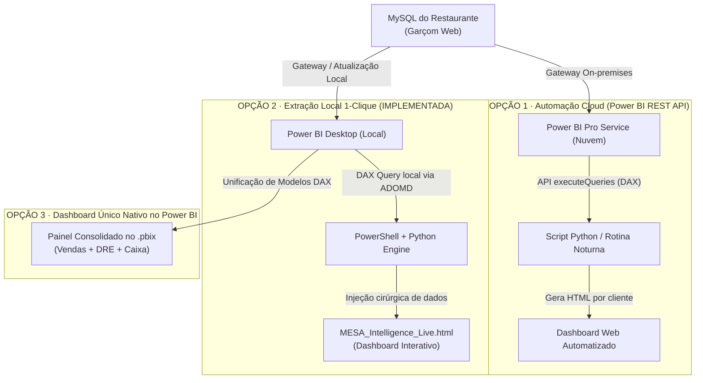

# 🍽️ MESA Intelligence · Integração Garçom Web via Power BI Gateway

[]()
[-blue.svg?style=flat-square)]()
[]()
[]()
[](https://jonatasndossantos.github.io/mesa-intelligence-powerbi-gateway/)

Projeto de inteligência gerencial e consolidação financeira para restaurantes da **Consultoria MESA**. Conecta diretamente ao banco de dados dos clientes (**Garçom Web - MySQL/ODBC**) através do **Microsoft On-premises Data Gateway**, alimentando um painel executivo interativo de alta fidelidade.

---

## 📌 Contexto e Desafio de Arquitetura

* **Escala:** ~1.200 clientes finais (piloto iniciado com 10 lojas selecionadas).
* **Segurança e Rede:** Restaurantes possuem IP dinâmico e firewalls locais. O **On-premises Data Gateway** já instalado resolve o tunelamento seguro sem necessidade de portas abertas ou VPNs dedicadas.
* **Licenciamento:** Operação viabilizada 100% sobre o **Power BI Pro** existente, eliminando os custos proibitivos de capacidades Microsoft Fabric (US$ 260+/mês) na fase de validação do MVP.

---

## 🧭 Comparativo dos 3 Formatos Estratégicos

Para atender ao plano de testes da consultoria sem investimento inicial em infraestrutura em nuvem, definimos 3 caminhos complementares:



### 📊 Matriz Comparativa

| Critério | Opção 1: Nuvem Pro (REST API) | Opção 2: Local 1-Clique (Desktop DAX) ⚡ | Opção 3: Dashboard Único PBI |
|---|---|---|---|
| **Status** | Roteiro pronto para ativação | **✅ Implementado e Validado** | Em modelagem visual |
| **Custo Mensal** | **R$ 0** (incluso no Power BI Pro) | **R$ 0** (incluso no Power BI Desktop) | **R$ 0** (incluso no Power BI Pro) |
| **Interface de Entrega** | HTML MESA Intelligence (Web) | HTML MESA Intelligence (Web) | Relatório Nativo Power BI (.pbix) |
| **Dependência Local** | Nenhuma (roda na nuvem) | Requer Power BI Desktop aberto | Requer Power BI Service ou App |
| **Velocidade de Execução** | ~5 a 10s via API REST | **~3 a 8s via porta local** | Instantâneo ao abrir o relatório |
| **Automação** | 100% autônomo (via cron/scheduler) | Manual (1 duplo-clique no `.bat`) | Automático via agendamento do Pro |
| **Ideal para...** | Envio de relatórios em escala | **Reuniões de consultoria e diagnósticos rápidos** | Analistas que já operam no Power BI |

---

## ⚡ Opção 2: Detalhes da Solução Implementada

A **Opção 2** foi implementada com foco em fricção zero para a equipe de consultoria:

1. **Auto-detecção de Instância:** O script local localiza o processo do Power BI Desktop (`PBIDesktop.exe`), descobre o processo filho do Analysis Services (`msmdsrv.exe`) e identifica dinamicamente a porta TCP ativa (ex: `50566`, `64009`), dispensando configurações manuais.
2. **Conexão Nativa ADOMD.NET:** Utiliza a biblioteca oficial `Microsoft.PowerBI.AdomdClient.dll` para submeter consultas DAX ultrarrápidas diretamente contra a engine de dados em memória.
3. **Resiliência a Schemas Dinâmicos:** As consultas utilizam agregações nativas sobre as tabelas acumuladas (`gw_vendas_acumulado`, `gw_caixa_detalha_acumulado`, `Financeiro`), imunes a variações regionais ou renomeações de colunas do calendário.
4. **Injeção Cirúrgica no HTML:** O script Python substitui apenas o payload da variável `const DATA = { ... }` dentro do template da consultoria, mantendo 100% da reatividade, gráficos e regras de negócio da interface.

### 📈 Métricas Reais Extraídas das Lojas Piloto

No teste executado com os restaurantes **WORLD CAFE** e **TEMPLO DO RAIMUNDAO**, foram consolidados:
* **Períodos:** 118 meses de histórico de vendas (R$ 15,7M acumulados)
* **Produtos:** 33.713 registros de movimentação de itens e curva ABC
* **Perdas:** 2.000 registros auditados de cancelamentos e motivos
* **Financeiro / DRE:** 5.000 lançamentos de competência, caixas e centros de custo
* **Formas de Pagamento:** 1.652 registros de fechamento de caixa por meio

---

## 🌐 Links Públicos e Acesso Multi-Tenant (GitHub Pages)

Para permitir que a consultoria compartilhe o painel com segurança (onde um cliente **não** enxerga os dados do outro), o sistema gera visões isoladas automaticamente:

| Painel | URL no GitHub Pages | Escopo de Dados | Tamanho |
|---|---|---|---|
| **👑 Visão Master (Consultoria MESA)** | [Acessar Painel Master](https://jonatasndossantos.github.io/mesa-intelligence-powerbi-gateway/) | Todas as lojas consolidadas + comparativo | 8.2 MB |
| **🚪 Portal Multi-Tenant** | [Acessar Portal de Lojas](https://jonatasndossantos.github.io/mesa-intelligence-powerbi-gateway/lojas/) | Lista e links de todas as lojas piloto ativas | 4 KB |
| **🏪 World Café (Loja 10603)** | [Acessar World Café](https://jonatasndossantos.github.io/mesa-intelligence-powerbi-gateway/lojas/10603.html) | **100% exclusivo** (R$ 9,01M faturamento / zero dados de terceiros) | 6.1 MB |
| **🏪 Templo do Raimundão (Loja 15173)** | [Acessar Raimundão](https://jonatasndossantos.github.io/mesa-intelligence-powerbi-gateway/lojas/15173.html) | **100% exclusivo** (R$ 6,76M faturamento / zero dados de terceiros) | 4.9 MB |

---

## 🚀 Como Executar Localmente

### Opção 2 · Extração Local 1-Clique (Recomendada para Diagnósticos)
Dê um duplo clique no arquivo:
```cmd
atualizar_dashboard.bat
```
O script irá:
1. Conectar-se automaticamente ao Power BI Desktop aberto.
2. Extrair todas as tabelas em ~5 segundos via ADOMD.NET.
3. Injetar os dados no dashboard Master e gerar os arquivos isolados por cliente em `lojas/`.
4. Realizar o commit e push automático para o GitHub Pages.
5. Abrir a visualização atualizada no seu navegador padrão.

### Opção 1 · Extração Nuvem (Power BI Service REST API)
Para atualizar os dados diretamente da nuvem sem precisar abrir o Power BI Desktop:
1. Na primeira vez, faça o login seguro via Microsoft Device Code:
```cmd
python scripts/pbi_cloud_api.py --login
```
2. Liste os datasets e workspaces disponíveis na sua conta Pro:
```cmd
python scripts/pbi_cloud_api.py --list
```
3. Preencha o `workspace_id` e `dataset_id` no arquivo `scripts/cloud_config.json`.
4. Dê um duplo clique em `atualizar_nuvem.bat` para atualizar e republicar tudo automaticamente via nuvem!

---

## 📂 Estrutura do Repositório

```text
powerbi_gateway_mysql_mvp/
├── atualizar_dashboard.bat       # 1-clique para extração local (Power BI Desktop)
├── atualizar_nuvem.bat           # 1-clique para extração cloud (Power BI Service REST API)
├── index.html                    # Entrada do GitHub Pages (Visão Master Consolidada)
├── MESA_Intelligence_Live.html   # Cópia local do Dashboard Master
├── README.md                     # Documentação técnica e arquitetural
├── .gitignore                    # Filtro de credenciais e caches
├── lojas/                        # Módulo Multi-Tenant (Isolamento por Cliente)
│   ├── index.html                # Portal de seleção de clientes
│   ├── 10603.html                # Painel exclusivo World Café
│   └── 15173.html                # Painel exclusivo Templo do Raimundão
└── scripts/
    ├── exportar_dados_pbi.ps1    # Extrator DAX via ADOMD.NET (PowerShell)
    ├── gerar_html_live.py        # Motor Multi-Tenant de injeção JSON (Python)
    ├── pbi_cloud_api.py          # Conector Power BI Service REST API (OAuth2)
    └── cloud_config.example.json # Modelo de configuração para a nuvem
```

---

## 🔮 Roteiro de Expansão (Próximas Fases)

### Ativação da Opção 1 (Automação Nuvem)
* Já implementada em `scripts/pbi_cloud_api.py` com suporte a OAuth2 RFC 8628 (Device Code).
* Permite agendamentos em servidores locais ou GitHub Actions sem interface gráfica.

### Ativação da Opção 3 (Dashboard Nativo)
* Modelar uma página executiva "MESA Master" dentro do próprio `.pbix`.
* Combinar as medidas de `Medidas Vendas`, `Medidas Caixa` e `Medidas DRE` em um layout executivo escuro equivalente ao padrão visual do HTML.

---

*Desenvolvido para **Consultoria MESA** · Gestão Financeira e Inteligência para Hospitalidade.*
